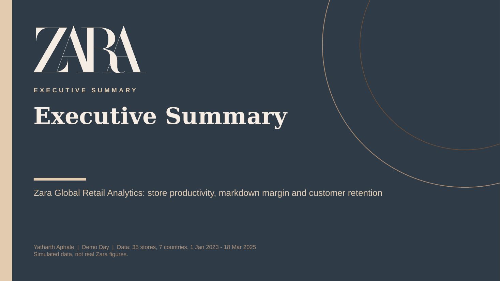

<h1 align="center">Zara Global Retail Analytics Capstone</h1>

<p align="center">
  
  
  
  
  
  
</p>

<p align="center">
  
</p>

## Overview

An end-to-end analytics capstone on simulated Zara retail data (1 Jan 2023 to 18 Mar 2025, 3.34M invoice lines, net sales **$126.58M**). Three problem statements are answered with three tools, each framed with business-analysis frameworks first and closed with prioritised recommendations:

- **PS1, Store performance and workforce productivity (Excel)** — which stores and staff turn traffic into sales, and where headcount does not match sales.
- **PS2, Pricing, promotions and margin (SQL)** — how markdowns, sale phases and Black Friday affect margin.
- **PS3, Customer and sales performance (Power BI)** — growth, cohort retention, RFM segments and customer value.

*Data is simulated for teaching and does not represent Zara.*

---

## Key Metrics at a Glance

| Metric | Value |
|---|---|
| Net sales (26 months) | $126.58M |
| Net sales 2023 / 2024 | $57.49M / $58.22M (+1.3%) |
| Gross margin 2023 / 2024 / 2025 YTD | 47.40% / 46.36% / 43.77% |
| Invoices | 1,786,791 |
| Average basket value | $70.84 |
| Return rate | 10.89% |
| Sales per employee | $72.9K (Zeil $40.1K to Fifth Avenue $150.6K) |

---

## Frameworks Applied

| Framework | Used for |
|---|---|
| SCQ, issue trees | Framing each problem statement and splitting it into testable branches |
| Causal loop diagrams | Reinforcing loops behind discount dependence and store pressure |
| Stakeholder grid, personas | Who owns each decision and who is affected |
| Metric tree, North Star, AARRR | Choosing the metric each problem moves |
| Hypotheses, A/B test design | Verdicts backed by the Part B evidence; the retention test |
| Impact-effort 2x2, RICE | Prioritising the recommendations |
| BRD, Jira epic and user stories | Turning the Weekly Store Scorecard into build-ready requirements |

---

## Tech Stack

```
Microsoft Excel      → Power Query summaries, Power Pivot model, DAX measures, slicer dashboard
MySQL 8              → CTEs, window functions (LAG, running SUM), stored procedure promo_report
Microsoft Power BI   → Star schema, DAX (YoY, YTD, rolling 3M, RFM), 5 report pages
```

---

## Key Insights

1. **Store gap is traffic, not basket** — Fifth Avenue serves 2,718 invoices per employee against 662 at Zeil; sales per employee spans 3.75x.
2. **Markdowns beyond 50% lose money** — margin is 50.0% at full price, 21.2% at 40-50% off and -47.5% at 60-70% off.
3. **Only the first sale phase pays** — Black Friday 2024 added +$42,321 margin per day, while US/UK full-price sales fell 11.4% before Christmas against +3.6% elsewhere.
4. **First-time customers are the leak** — cohort retention runs 18-34%; customers whose first purchase was on markdown repeat at 42.29% against 51.25%.
5. **Growth sits in the US, not China** — US +14.4% and China -12.1% (Power BI); the top 20% of customers deliver 60.14% of revenue.

---

## Key Recommendations

| # | Recommendation |
|---|---|
| 01 | Cap markdowns at 50%, retire the 60-70% tier and keep Black Friday on overbought lines only |
| 02 | Rebalance staff hours toward Friday and Saturday and pilot moving roles to short-staffed flagships |
| 03 | Launch a retention journey for markdown-first customers and test it with an A/B design |
| 04 | Buy 10% less of overbought sub-categories and fix the high-return Z1975 jeans and dresses |

---

## Repository Structure

```
Yatharth_Aphale_Zara_Capstone
├── 1_Framing_Notes/        ← PS1, PS2, PS3 framing notes, Part A deck, Part C recommendations
├── 2_Excel_Problem1/       ← Annotated dashboard deck, dashboard and model images (add the .xlsx here)
├── 3_SQL_Problem2/         ← Commented .sql file and SQL slides with query outputs
├── 4_PowerBI_Problem3/     ← Annotated pages deck and screenshots (add the .pbix here)
├── 5_Executive_Summary/    ← 10-slide executive summary (pptx + pdf)
├── data/                   ← Note on the raw data files
├── cover.png               ← Repo cover image
├── UPLOAD_GUIDE.md         ← Git LFS command-prompt guide
└── README.md
```

---

## About Me

**Yatharth Aphale**
Business Analyst

[](https://www.linkedin.com/in/yatharth-aphale-338b203b8)
[](https://github.com/Yatharth-2206)
[](mailto:aphaleyatharth@gmail.com)

*If this project was useful, a star on the repo is appreciated — feel free to reach out for feedback, questions, or opportunities.*
